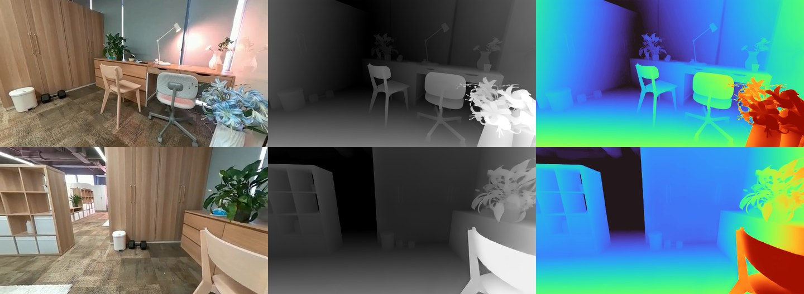

# ComfyUI-DVDepth

Native ComfyUI support for **[DVD: Deterministic Video Depth](https://github.com/EnVision-Research/DVD)**
(EnVision Research): temporally stable relative depth for a whole video, from a Wan 2.1 model, in one forward
pass per window of frames. No sampling, no flicker, one consistent scale across clips of any length.

<p align="center"></p>

- **No requirements.** Pure ComfyUI. Nothing is installed, no model code is shipped, no text encoder is needed.
- **Stock loaders.** DVD is Wan 2.1 T2V 1.3B with a merged LoRA, and ComfyUI implements Wan 2.1 natively. The
  converted weights load with Load Diffusion Model as a plain Wan 2.1 model, the stock Wan 2.1 VAE does the
  encoding and decoding, and ComfyUI's offloading, dtypes, attention backends, LoRA and `torch.compile` apply
  as for any other Wan model.
- **One node.** **DVD Video Depth** runs the deterministic pass through ComfyUI's sampler machinery and adds
  what DVD's own script does around it: frames resized to the training box, windows of 81 frames aligned
  (scale + shift) and cross-faded over their overlap, the depth resized back, normalised, optionally coloured.
- **Verified.** The ComfyUI path matches the reference implementation to 1e-6 in fp32 and to 0.6% in fp16
  (`tests/parity.py`), and runs 1.4 to 1.6× faster than the reference pipeline that
  [comfy-dvd](https://github.com/spiritform/comfy-dvd) wraps, with 2 GB less VRAM and no dependencies.

## Install

Clone into `ComfyUI/custom_nodes` and restart ComfyUI:

```bash
cd ComfyUI/custom_nodes
git clone https://github.com/Nynxz/ComfyUI-DVDepth
```

Needs a ComfyUI with Wan 2.1 support (0.3.27 or newer; the node uses the current node API, 0.3.60 or newer).

## Models

| File | Folder | Size | Download |
|---|---|---|---|
| `dvd_1.1_bf16.safetensors` | `models/diffusion_models` | 2.84 GB | [nynxz/DVD](https://huggingface.co/nynxz/DVD) |
| `wan_2.1_vae.safetensors` | `models/vae` | 0.25 GB | [Comfy-Org/Wan_2.1_ComfyUI_repackaged](https://huggingface.co/Comfy-Org/Wan_2.1_ComfyUI_repackaged/tree/main/split_files/vae) |

`dvd_1.1_bf16.safetensors` is DVD v1.1 (April 2026: more robust to reflective surfaces, better temporal
consistency) with its rank-512 LoRA merged into the Wan 2.1 base, made with
[`scripts/convert.py`](#making-the-weights). `dvd_1.0_bf16.safetensors` (the first release) is on the same
repo. The VAE is the ordinary Wan 2.1 VAE; if you run Wan 2.1 in ComfyUI you already have it (the copy inside
DVD's checkpoint is bit-identical). DVD conditions on an all-zero text context, so no umt5 is needed.

The weights are released by their authors under **CC BY-NC 4.0** (non-commercial use). The code here is
Apache-2.0.

## Workflow

Drag **[example_workflows/dvd_video_depth.json](example_workflows/dvd_video_depth.json)** into ComfyUI, or
open it from **Templates → Custom Nodes → ComfyUI-DVDepth**. It includes a short demo clip:

| Node | Setting |
|---|---|
| Load Video → Get Video Components | the clip (`dvd_robot_navi.mp4`, or upload your own) |
| Load Diffusion Model | `dvd_1.1_bf16.safetensors` |
| Load VAE | `wan_2.1_vae.safetensors` |
| **DVD Video Depth** | `height` 480 `width` 640, `window_size` 81, `overlap` 21, `normalize` video |
| Create Video → Save Video | the depth video at the input's frame rate |

Any image batch works as input, including a single image.

### Settings

- **height × width** (480 × 640): the frames are scaled, keeping their aspect ratio, to *cover* this box
  (rounded up to multiples of 16), and the depth is resized back to the input size. This is how DVD's script
  works and 480 × 640 is its setting: a 1280 × 720 clip is processed at 880 × 480, a portrait 720 × 1280 clip
  at 640 × 1152. Larger boxes are slower (attention grows with the token count) and off the training
  distribution; smaller ones are faster and softer.
- **window_size** (81) and **overlap** (21): frames per forward pass (4n+1, the Wan VAE's temporal stride) and
  the frames consecutive windows share. Each new window is fitted to the previous one with a least-squares
  scale and shift on the shared frames (clipped to 0.7 to 1.5) and cross-faded there, the paper's global
  affine coherence. These are the settings of DVD's demo app. Lower the window for less VRAM; raise the
  overlap for steadier scale across long clips at the cost of more windows.
- **normalize**: `video` maps the whole clip's min/max to 0..1, so the scale stays consistent from frame to
  frame (DVD's visualisation). `frame` normalises every frame on its own. `none` returns the decoded values as
  they are: relative, affine-invariant disparity in 0..1.
- **colormap** `turbo` colours the depth; **invert** flips near and far (DVD predicts near = bright).
- **output_size** `model` keeps the processing size instead of resizing back, which on long high-resolution
  clips is a lot less memory for the IMAGE batch.
- Advanced: **denoise_step** (0.5) is the fixed timestep DVD regresses at (timestep = 1000 × this), part of
  the trained model; **scale_only** aligns windows with a scale only.

### Speed and memory

On an RTX 5090, fp16 (what Load Diffusion Model picks by default), 181 frames of a 1280 × 704 clip:

| | processing size | per 81-frame window | whole clip (3 windows) | peak VRAM |
|---|---|---|---|---|
| DVD Video Depth, default box 480 × 640 | 880 × 480 | 6.9 s | 20.7 s (8.7 frames/s) | 7.1 GB |
| DVD Video Depth, box 352 × 640 | 640 × 352 | 3.4 s | 10.2 s (17.8 frames/s) | 5.2 GB |
| DVD's own pipeline as [comfy-dvd](https://github.com/spiritform/comfy-dvd) runs it (diffsynth, bf16), box 480 × 640 | 880 × 480 | 10.8 s | 32.3 s (5.6 frames/s) | 9.3 GB |
| same, at comfy-dvd's default scale 0.5 | 640 × 352 | 4.6 s | 13.8 s (13.1 frames/s) | 7.1 GB |

The reference path also spends 17 s per session loading the Wan base weights and merging the LoRA with peft;
here the merged file loads lazily like any other model.

Of a window at 880 × 480, about a quarter is the DiT (1.5 s) and the rest the Wan VAE, encoding the frames and
decoding the depth (3.1 s); ComfyUI's VAE and attention implementations are where the gain over the reference
comes from, and the VAE is the ceiling: batching windows into one forward pass gains nothing. The model
takes 2.8 GB in fp16; the rest of the VRAM is activations, which scale with the processing size and window.
ComfyUI's tiled VAE fallback kicks in automatically on smaller cards.

## Tips

- **Long clips.** Memory for the IMAGE batches (input frames and output depth) is the limit, not the model:
  a 1280 × 720 frame is 11 MB as a float tensor. Use `output_size` `model`, or process in chunks, for clips
  of thousands of frames.
- **Single images and short clips** work: a single frame is one window of one frame (DVD was also evaluated
  on image depth benchmarks).
- **Scale.** The output is relative depth with an unknown affine scale and offset, like Depth Anything: good
  for ControlNet, relighting, parallax, masks and compositing; not metric.
- **fp16.** Load Diffusion Model picks fp16 on most GPUs. It is within 0.6% of the fp32 reference here (closer
  than the reference's own bf16 run); `--bf16-unet` or the fp8 weight dtypes are the usual ComfyUI options.

## Nodes

**DVD Video Depth** (`image/geometry estimation`): MODEL + VAE + IMAGE → IMAGE (depth, 3-channel grayscale or
turbo). Inputs as above.

## Making the weights

`scripts/convert.py` turns a DVD checkpoint (the state of diffsynth's pipeline: the Wan DiT with an unmerged
peft LoRA under `pipe.dit.*`, and the VAE under `pipe.vae.*`) into a ComfyUI Wan 2.1 diffusion model file.
It merges the LoRA into the base weights in fp32 (W + B·A, peft's scaling of 1), drops the prefixes, checks
that ComfyUI will detect a Wan 2.1 T2V 1.3B, and saves in bf16 (or `--dtype fp16`):

```bash
python scripts/convert.py --src FayeHongfeiZhang/DVD --file dvd_1.1.safetensors --out /path/to/ComfyUI/models
```

Needs only `torch`, `safetensors` and `huggingface_hub`. Add `--vae-out` to also write the bundled VAE
(identical to Comfy-Org's).

## Tests

`tests/reference.py` runs the reference implementation (diffsynth's model and VAE from a clone of the DVD
repo, the LoRA merged with peft exactly as `test_single_video.py` does) and saves its outputs;
`tests/parity.py` runs the ComfyUI path on the same inputs and compares: the DiT alone on a fixed latent (fp32:
rel. error 1.2e-6 against the same weights, 3e-3 against peft's bf16 merge; fp16: 5.6e-3 against fp32), and the
whole clip (per-window depth within 1%, the stitched, normalised clip within 0.2% of range on average).
`tests/e2e.py` runs the example graph headlessly on a video and writes the depth video and a contact sheet.

```bash
DVD_REPO=/path/to/DVD DVD_PYDEPS=/path/with/peft python -I tests/reference.py unit --ckpt dvd_1.1.safetensors --merged dvd_1.1_bf16.safetensors --out unit.npz
DVD_REPO=/path/to/DVD DVD_PYDEPS=/path/with/peft python -I tests/reference.py video --ckpt dvd_1.1.safetensors --video clip.mp4 --frames 181 --out e2e.npz
python tests/parity.py --comfy /path/to/ComfyUI --model dvd_1.1_bf16.safetensors --unit unit.npz --e2e e2e.npz --vae wan_2.1_vae.safetensors --out out/
python tests/e2e.py --comfy /path/to/ComfyUI --video example_workflows/dvd_robot_navi.mp4 --out out/
```

## Credits

- **DVD** by Hongfei Zhang, Harold H. Chen, Chenfei Liao, Jing He et al., EnVision Research, HKUST(GZ):
  [paper](https://arxiv.org/abs/2603.12250), [code](https://github.com/EnVision-Research/DVD) (Apache-2.0),
  [weights](https://huggingface.co/FayeHongfeiZhang/DVD) (CC BY-NC 4.0).
- **Wan 2.1** by Wan-AI (Apache-2.0); ComfyUI's implementation of it and its Wan VAE.
- [spiritform/comfy-dvd](https://github.com/spiritform/comfy-dvd), the first ComfyUI node for DVD, which wraps
  the reference pipeline and its dependencies.
